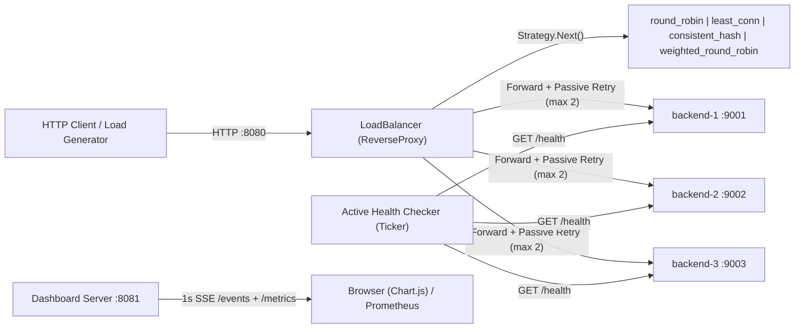

# Go HTTP Load Balancer

HTTP Load Balancer ringan berbasis **Go 1.22+** yang berdiri di depan beberapa server backend HTTP, meneruskan trafik hanya ke backend sehat, mendukung pemilihan strategi *load balancing* via konfigurasi YAML, *active & passive health check*, *real-time telemetry dashboard* berbasis Server-Sent Events (SSE) + Chart.js, serta eksposisi metrik format Prometheus.

Dibangun hampir seluruhnya memakai **Go standard library** (`net/http/httputil`, `sync/atomic`, `log/slog`, `embed`), dengan satu-satunya dependensi eksternal `gopkg.in/yaml.v3`.

---

## Arsitektur



### Struktur Direktori

```text
cmd/
  lb/main.go                      # Entrypoint HTTP Load Balancer + Graceful Shutdown
  backend/main.go                 # Dummy HTTP backend untuk pengujian (-delay, -fail)
internal/
  config/                         # Parser & validator ketat YAML (gopkg.in/yaml.v3)
  backend/                        # Model Backend, ReverseProxy, & metrik atomic
  strategy/                       # RoundRobin, LeastConnections, ConsistentHash, Smooth WRR
  health/                         # Active health checker berbasis time.Ticker
  proxy/                          # Handler LoadBalancer, passive ErrorHandler, & retry
  dashboard/                      # Server SSE (/events), Prometheus (/metrics), & web/index.html
config.yaml                       # Konfigurasi default untuk eksekusi lokal
config.docker.yaml                # Konfigurasi untuk Docker Compose
Dockerfile                        # Multi-stage build image Go statis
docker-compose.yml                # 1 Load Balancer + 3 Backend container
```

---

## Fitur Utama

- **Reverse Proxy (`net/http/httputil.ReverseProxy`)**: Meneruskan request lengkap beserta header `X-Forwarded-For` dan `X-Forwarded-Host`.
- **4 Algoritma Load Balancing (`Strategy` interface)**:
  - `round_robin`: Giliran memakai counter `atomic.Uint64`, otomatis melewati backend mati tanpa menumpuk beban ganda pada node berikutnya.
  - `least_conn`: Memilih backend sehat dengan koneksi *in-flight* paling sedikit (dengan rotasi *tie-breaker* saat seri).
  - `consistent_hash`: *Hash ring* SHA-256 dengan **100 virtual node per backend** berdasarkan IP client (`X-Forwarded-For` → `X-Real-IP` → `RemoteAddr`), menjaga *session affinity* dan meminimalkan perpindahan key saat node berubah.
  - `weighted_round_robin`: *Smooth Weighted Round Robin* sesuai bobot `weight` tiap backend.
- **Health Check Ganda**:
  - **Aktif**: Goroutine `time.Ticker` memanggil `GET <path>` secara paralel; backend ditandai **mati setelah 3 kegagalan berturut-turut** dan **hidup kembali setelah 2 sukses berturut-turut**.
  - **Pasif**: `ErrorHandler` pada `ReverseProxy` langsung menandai backend mati saat gagal dihubungi dan otomatis me-*retry* ke backend sehat lain (**maksimal 2 kali**, termasuk me-*replay* body request hingga 1 MiB).
- **Dashboard Real-Time (`:8081`) & Prometheus (`/metrics`)**:
  - Halaman HTML tunggal ter-*embed* (`go:embed`) + SSE `/events` tiap 1 detik berisi status tiap backend, koneksi aktif, total request, error, RPS, dan latensi rata-rata dengan grafik Chart.js.
  - Endpoint `/metrics` dalam format teks Prometheus v0.0.4.
- **Graceful Shutdown**: Menangkap `SIGINT` / `SIGTERM`, menghentikan *health checker* & stream SSE dengan bersih, serta menyelesaikan request yang sedang berjalan sebelum proses berhenti.

---

## Cara Menjalankan

### Opsi 1: Menggunakan Docker Compose (Direkomendasikan untuk Demo Cepat)

Menjalankan 1 container load balancer (`:8080` & `:8081`) beserta 3 container backend (`backend-1`, `backend-2`, `backend-3`):

```bash
docker compose up --build -d
```

Uji trafik ke load balancer dan pantau status:

```bash
for i in {1..6}; do curl -s http://localhost:8080/; done
curl -s http://localhost:8081/api/stats
curl -s http://localhost:8081/metrics
```

Buka juga halaman dashboard web pada port `:8081` di browser Anda. Untuk menghentikan seluruh container:

```bash
docker compose down
```

### Opsi 2: Menjalankan Langsung dengan Go (Lokal)

Prasyarat: **Go 1.22+**.

1. Jalankan 3 instance dummy backend di latar belakang:
   ```bash
   go run ./cmd/backend 9001 &
   go run ./cmd/backend 9002 &
   go run ./cmd/backend 9003 &
   ```
2. Jalankan load balancer memakai `config.yaml`:
   ```bash
   go run ./cmd/lb -config config.yaml
   ```
   *(Opsional: Anda dapat menimpa strategi tanpa mengedit file YAML dengan flag `-strategy`, misal `go run ./cmd/lb -config config.yaml -strategy round_robin`.)*

---

## Konfigurasi YAML

Contoh `config.yaml`:

```yaml
listen: ":8080"
dashboard: ":8081"
strategy: least_conn   # round_robin | least_conn | consistent_hash | weighted_round_robin
shutdown_timeout: 10s  # opsional (default: 10s)
health_check:
  path: /health
  interval: 5s
  timeout: 2s
backends:
  - url: http://localhost:9001
    weight: 1
  - url: http://localhost:9002
    weight: 1
  - url: http://localhost:9003
    weight: 1
```

---

## Pengujian Otomatis

Jalankan seluruh unit test dan integration test lengkap dengan *race detector*:

```bash
go test -v -race ./...
```

---

## Skenario Eksperimen & Uji Beban

### Skenario 1: Backend Mati Mendadak & Pemulihan Otomatis

1. Jalankan tumpukan Docker Compose:
   ```bash
   docker compose up -d
   ```
2. Matikan `backend-2` secara tiba-tiba:
   ```bash
   docker compose stop backend-2
   ```
3. Kirim request beruntun ke load balancer:
   ```bash
   for i in {1..6}; do curl -i -s http://localhost:8080/ | head -n 1; done
   ```
   - **Hasil**: Seluruh request tetap mengembalikan `HTTP/1.1 200 OK`! Request pertama yang mengarah ke `backend-2` gagal terkoneksi, langsung ditandai *unhealthy* oleh **passive health check**, dan otomatis di-*retry* ke backend sehat lain tanpa terlihat error di sisi client.
   - Pada dashboard (`:8081`), status `backend-2` berubah menjadi **Unhealthy**.
4. Hidupkan kembali `backend-2`:
   ```bash
   docker compose start backend-2
   ```
   - Setelah **2 kali** pemeriksaan aktif `GET /health` berturut-turut berhasil (~10 detik untuk interval `5s`), `backend-2` otomatis kembali berstatus **Healthy** dan menerima trafik.

---

### Skenario 2: Backend Lambat & Uji Beban (`Round Robin` vs `Least Connections`)

Skenario ini menunjukkan keunggulan `least_conn` dibanding `round_robin` ketika salah satu backend mengalami degradasi performa (misalnya GC pause atau query database lambat).

1. Hentikan proses sebelumnya, lalu jalankan **1 backend lambat (`-delay 300ms`)** dan **2 backend cepat**:
   ```bash
   pkill -f "cmd/backend" || true
   go run ./cmd/backend 9001 -delay 300ms &
   go run ./cmd/backend 9002 &
   go run ./cmd/backend 9003 &
   ```

2. **Uji A — Jalankan Load Balancer dengan `round_robin`**:
   ```bash
   go run ./cmd/lb -config config.yaml -strategy round_robin
   ```
   Di terminal lain, jalankan uji beban konkuren memakai **`hey`** (600 request, konkurensi 30) atau **`wrk`** (4 thread, 30 koneksi, durasi 10 detik):
   ```bash
   # Menggunakan hey:
   hey -n 600 -c 30 http://localhost:8080/

   # Atau menggunakan wrk:
   wrk -t4 -c30 -d10s http://localhost:8080/
   ```
   **Pengamatan pada `round_robin`**:
   - Karena `round_robin` membagi rata 1/3 trafik (200 request) secara buta ke `9001` yang lambat (`300ms`), antrean koneksi aktif menumpuk di `9001`.
   - Latensi rata-rata dan persentil p90/p99 membengkak (~100ms–300ms), dan total RPS tertahan oleh backend paling lambat.

3. **Uji B — Ganti strategi ke `least_conn`**:
   Hentikan `lb` (`Ctrl+C`), lalu jalankan kembali dengan `least_conn`:
   ```bash
   go run ./cmd/lb -config config.yaml -strategy least_conn
   ```
   Jalankan perintah beban yang sama:
   ```bash
   # Menggunakan hey:
   hey -n 600 -c 30 http://localhost:8080/

   # Atau menggunakan wrk:
   wrk -t4 -c30 -d10s http://localhost:8080/
   ```
   **Pengamatan pada `least_conn`**:
   - Begitu `9001` sedang menahan beberapa koneksi aktif yang lambat, `least_conn` melihat bahwa `9002` dan `9003` memiliki koneksi aktif jauh lebih sedikit (`0`–`1`), sehingga mayoritas besar request diarahkan ke `9002` dan `9003`.
   - Pada grafik dashboard (`:8081`) maupun `curl -s http://localhost:8081/api/stats`, terlihat RPS `9002` & `9003` melonjak tinggi sementara `9001` hanya menerima sedikit request, menghasilkan **RPS klaster berkali-kali lipat lebih tinggi** dan **latensi rata-rata jauh lebih rendah**.

---

### Skenario 3: Simulasi Backend Error (`-fail`)

Flag `-fail` membuat dummy backend mengembalikan `HTTP 500` baik di `/` maupun `/health`:

```bash
go run ./cmd/backend 9001 -fail &
go run ./cmd/backend 9002 &
go run ./cmd/backend 9003 &
go run ./cmd/lb -config config.yaml
```

Setelah 3 kali kegagalan berturut-turut pada active health check, `9001` otomatis dikeluarkan dari rotasi hingga kembali sehat.

---

### Skenario 4: Consistent Hashing (Sticky Client IP)

```bash
go run ./cmd/lb -config config.yaml -strategy consistent_hash
```

Kirim beberapa request dengan simulasi IP client lewat `X-Forwarded-For`:

```bash
for i in {1..5}; do
  curl -s -H "X-Forwarded-For: 198.51.100.25" http://localhost:8080/
done
```

Seluruh request dari IP `198.51.100.25` selalu diarahkan ke instance backend yang sama selama backend tersebut sehat.
